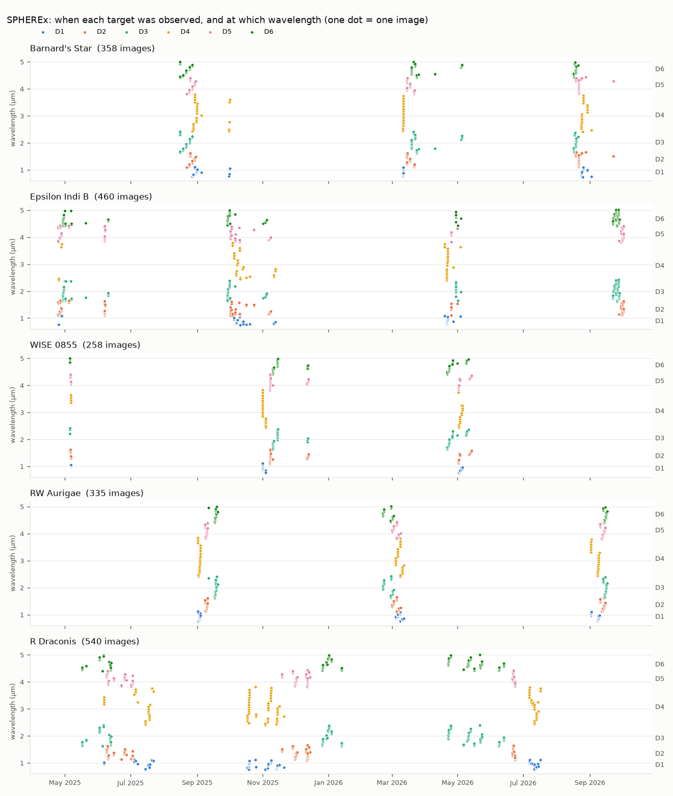

# SPHEREx data coverage of the test targets

> **Team note, not an official source.** Everything here was measured by us on **2026-11-14** with the scripts in `backend/scripts/`, against IRSA collections `spherex_dr1` and `spherex_qr3`. SPHEREx data grows weekly, so the counts will go up. Re-run the scripts (see the end) rather than trusting these numbers later.

Questions this note answers:
- What do the search results contain for one target?
- When was it observed, on which detector, and at what wavelength?
- Do we get every object at every wavelength every 6 months?
- What does this mean for the blink tool and a wavelength view?



*One dot is one image. Height is the wavelength **at the target's position** in that image, and colour is the detector. The labels D1–D6 on the right mark each detector's band.*

---

## 1. Summary

1. **There's no fixed schedule.** Each sky position has its own dates and number of images.
2. **A target is observed in seasons about 6 months apart.** Each season lasts 2–8 weeks. So far each target has 3–4 seasons, from May 2025 to Oct 2026.
3. **One season usually gives one full spectrum.** All 6 detectors, about all 17 channels each, typically 17–25 images per detector. That is the survey design.
4. **The spectrum isn't taken all at once.** It is spread over about 3 weeks. The detectors come in fixed pairs (D1+D4, D2+D5, D3+D6), and each pair scans its band in one block of a few days. The order of the pairs varies.
5. **Some seasons are incomplete:** the mission start (May 2025), some partial seasons, and data not yet released (autumn 2026 for some targets).
6. **Positions near the ecliptic poles get much more data.** R Draconis has 540 images, and its seasons blur together.

---

## 2. Background: why the wavelength is "per image"

These terms are explained more fully in `docs/RESOURCES.md` and `docs/spherex/user-guide-data-products.md`.

- **Detector (D1–D6).** SPHEREx has 6 detectors, each covering one wavelength band from 0.75 µm (D1) to 5.0 µm (D6). Each search result is **one image from one detector**.
- **Linear variable filter.** Within one detector the wavelength changes smoothly along one axis of the image. Every star in an image is measured at the wavelength of its own position on the detector.
- **"17 channels"** is just a division of each detector's gradient into 17 strips. It isn't 17 separate images, and there's nothing to cut out.
- **How a spectrum is built.** Between exposures the telescope shifts slightly, so a target lands at a different position, and therefore a different wavelength. Collecting many images gives one point per image, and the points make a spectrum.

So "what wavelength is this image?" only has an answer **for a given position** in it. That's what the chart plots.

---

## 3. Results per target

Each cell is **images / approximate channels hit (out of 17)**.

*The channel count is our approximation: 17 equal steps in log(wavelength) between the lowest and highest wavelength we measured for that detector. It isn't the official channel definition, which is in the Spectral Channels calibration product (not used here).*

**Barnard's Star** (358 images)

| Season | D1 | D2 | D3 | D4 | D5 | D6 |
|---|---|---|---|---|---|---|
| 2025-08-15 .. 10-01 | 24 / 17 | 18 / 17 | 18 / 17 | 23 / 17 | 18 / 17 | 17 / 16 |
| 2026-03-11 .. 05-05 | 18 / 17 | 18 / 16 | 24 / 17 | 18 / 17 | 19 / 17 | 24 / 17 |
| 2026-08-16 .. 09-22 | 18 / 17 | 25 / 17 | 17 / 17 | 18 / 17 | 24 / 17 | 17 / 17 |

**Epsilon Indi B** (460 images)

| Season | D1 | D2 | D3 | D4 | D5 | D6 |
|---|---|---|---|---|---|---|
| 2025-04-24 .. 06-10 | 3 / 3 | 32 / 16 | 25 / 14 | 4 / 3 | 30 / 16 | 24 / 14 |
| 2025-09-28 .. 11-12 | 24 / 17 | 30 / 16 | 23 / 17 | 23 / 17 | 24 / 17 | 22 / 17 |
| 2026-04-18 .. 05-04 | 19 / 17 | 7 / 6 | 12 / 10 | 19 / 17 | 6 / 6 | 11 / 10 |
| 2026-09-22 .. 10-02 | – | 24 / 17 | 36 / 17 | – | 24 / 17 | 36 / 17 |

**WISE 0855** (258 images, all DR1, none in QR3 yet)

| Season | D1 | D2 | D3 | D4 | D5 | D6 |
|---|---|---|---|---|---|---|
| 2025-05-05 .. 05-06 | 4 / 4 | 8 / 8 | 3 / 2 | 4 / 4 | 8 / 8 | 3 / 3 |
| 2025-10-31 .. 12-13 | 18 / 17 | 25 / 17 | 21 / 17 | 18 / 17 | 25 / 17 | 21 / 17 |
| 2026-04-21 .. 05-14 | 14 / 13 | 15 / 12 | 21 / 17 | 14 / 13 | 15 / 12 | 21 / 16 |

**RW Aurigae** (335 images): the textbook case

| Season | D1 | D2 | D3 | D4 | D5 | D6 |
|---|---|---|---|---|---|---|
| 2025-09-01 .. 09-20 | 19 / 17 | 18 / 17 | 19 / 17 | 19 / 17 | 18 / 17 | 19 / 17 |
| 2026-02-20 .. 03-12 | 19 / 17 | 19 / 17 | 19 / 17 | 19 / 17 | 19 / 17 | 19 / 17 |
| 2026-09-02 .. 09-16 | 18 / 17 | 18 / 16 | 18 / 17 | 18 / 17 | 19 / 17 | 18 / 17 |

In Sep 2025, D1+D4 were observed around 1–3 Sep, D2+D5 around 8–11 Sep and D3+D6 around 17–20 Sep.

**R Draconis** (540 images): near the north ecliptic pole, so lots of data

| Season | D1 | D2 | D3 | D4 | D5 | D6 |
|---|---|---|---|---|---|---|
| 2025-05-16 .. 07-22 | 23 / 17 | 33 / 17 | 23 / 15 | 21 / 17 | 32 / 17 | 22 / 15 |
| 2025-10-17 .. 2026-01-13 | 45 / 17 | 37 / 17 | 24 / 17 | 44 / 17 | 37 / 17 | 24 / 17 |
| 2026-04-22 .. 07-16 | 24 / 17 | 19 / 17 | 44 / 17 | 23 / 17 | 19 / 17 | 45 / 17 |

*Seasons are split wherever there is a gap of more than 30 days between images. For R Dra this threshold merges what may really be overlapping visits.*

### Which release holds which dates

The releases cover **different periods and don't overlap**. No image appeared in both:
- **DR1:** the first year, up to about mid-May 2026.
- **QR3:** everything since then, updated weekly.

Search both.

| Target | DR1 | QR3 |
|---|---|---|
| Barnard's Star | 2025-08-15 → 2026-05-05 | 2026-08-16 → 2026-09-22 |
| Eps Indi B | 2025-04-24 → 2026-05-04 | 2026-09-22 → 2026-10-02 |
| R Dra | 2025-05-16 → 2026-05-13 | 2026-05-16 → 2026-07-16 |
| RW Aur | 2025-09-01 → 2026-03-12 | 2026-09-02 → 2026-09-16 |
| WISE 0855 | 2025-05-05 → 2026-05-14 | none yet |

---

## 4. Patterns within a season

- **A run** is 2–4 exposures about 2 minutes apart, with the target stepping about 115 px along the filter each time. For WISE 0855 in D1 on 2025-10-31 the wavelength went 0.86 → 0.90 → 0.95 → … → 1.11 µm in two hours. These runs are the slanted dot columns in the chart.
- **Several runs over a few days** cover a detector pair's whole band.
- **The detector pairs** D1+D4, D2+D5 and D3+D6 always have the same image counts, because they see the same sky at the same moment. Each pair is observed in its own block of days within the season.

---

## 5. Consequences for the tool

| Feature | What the data allows |
|---|---|
| **Blink at fixed wavelength** | Almost every season covers every channel, so for a chosen wavelength there is usually one image per season. This is the cleanest motion view: only time changes. |
| **Broadband blink** | Stack all images of one detector per season. Best signal-to-noise. This is what the challenge suggests. |
| **Wavelength slider within a season** | Steps through images taken over 1–3 weeks. For variable stars (RW Aur, R Dra) that isn't one moment. Fast movers shift slightly (WISE 0855: about 0.5″ in 3 weeks, well under a 6″ pixel). |
| **Full spectrum** | About one complete spectrum per season. Incomplete seasons need a "partial coverage" indicator. |
| **Coverage chart in the UI** | The chart above could be the navigation: click a dot to open that image, a column to choose a season, a height to choose a wavelength. |
| **"No new data" message** | Some targets have no recent season yet (WISE 0855 since May 2026). The UI should show the date range of the data it has. |

---

## 6. Method (how the wavelength per image was obtained)

Files: `backend/app/spherex.py` (functions `search`, `fetch_image_header`, `SpectralMaps`, `locate_on_detector`).

1. **Search:** SIA2 on every SPHEREx collection IRSA lists, minus the All-Sky Cube and the deep fields. Collections are discovered automatically with `Irsa.list_collections(servicetype="SIA", filter="spherex")`.
2. **Header only:** each image's `IMAGE` header is read with HTTP **range requests**. The server returns `206 Partial Content`, and the header ends at about 26 KB, out of a 65 MB file.
3. **Target pixel:** `WCS(header).world_to_pixel(target)`, with the target's proper motion applied to that image's date.
4. **Wavelength:** the pixel is looked up in the **`CWAVE`** map (and `CBAND` for bandwidth) of the **Spectral WCS calibration product**, one 2040×2040 map per detector, about 33 MB, downloaded once. The docs recommend `CWAVE`/`CBAND` "for science analysis" (`docs/spherex/user-guide-data-products.md`). The wavelength map is a property of detector + filter, not of the pointing (`docs/spherex/tutorial-intro-spectral-images.md`).

**Validation:** for 24 Barnard's Star D2 images, the `CWAVE` lookup agreed with the exact `WCS-WAVE` value from the downloaded cutouts to within **0.6 nm** (median −0.3 nm).

**Cost:** about 30–75 s per target for 260–540 images, with no pixel data downloaded.

### Things we ran into

| Observation | Detail |
|---|---|
| Spectral WCS folder name differs from the docs | The docs give `spectral_wcs/cal-wcs-v…`, but the bucket has `spectral_wcs/cal-swcs-v5-2026-191/<det>/spectral_wcs_D<n>_spx_cal-swcs-v5-2026-191.fits` (same file in `dr1/` and `qr3/`). The code finds it by listing the bucket, so it isn't hard-coded. |
| Browsable directory root not reachable by script | `https://irsa.ipac.caltech.edu/ibe/data/spherex/` and `/dr1/` returned "Requested file was not found" to `curl`, although individual file URLs work. We list the public S3 bucket `nasa-irsa-spherex` instead. |
| Headers name calibration files by ID, not filename | The `IMAGE` header has e.g. `HISTORY [CALIB] spectral_wcs 019f4f99-…`, a UUID, so it can't be used to pick the file. |
| `VERSION` in a DR1 file | `'7.0.5'` (so `EPSF`, not `PSF`). |

---

## 7. Related test: Barnard's Star pipeline

`backend/scripts/fetch_barnard.py` runs the whole chain on detector D2 with a 0.05° field:

1. search
2. filter (detector, distance to the image edge)
3. group into seasons
4. cached cutouts with the PSF removed
5. subtract `ZODI` and mask bad pixels
6. reproject north-up
7. median-stack per season

Results:
- **3 seasons**, 8 cutouts each. The common grid is 30×30 px at 6.14″/px, read from the WCS.
- **The star's measured position** in each season stack lies within **0.05–0.4 px** of the position predicted from its proper motion.
- **Total motion:** 9.7″ between the first and last season, against 10.3″ expected.
- **Saturation:** in D2 the star is saturated. Every frame has `OVERFLOW`, `SUR_ERROR` and `BLOOM` set on the star, so a simple centroid failed by about 2 px. A 2D Gaussian fit that skips masked pixels works. Expect the same for any bright target, and for photometry or spectra.
- **Downloads fail because IRSA rate-limits (tested).** The cutout service answers `503 Server busy, retry later.` (25 bytes), often right after it has served one request. With 6 parallel workers and 3 quick retries, 102 of 349 cutouts failed on the first pass. With 3 workers and exponential backoff (5 s, 10 s, 20 s … up to 60 s, or the server's `Retry-After`) the 25 missing cutouts took 214 s (about 9 s each, mostly waiting on 503s), and 24 of them arrived on the first pass, the last on the retry pass. The first full pass (349 requested, 6 workers, short retries) took 784 s. The API must therefore limit its concurrency towards IRSA, back off on 503, and cache every successful cutout. We did not measure how many requests per minute IRSA tolerates, so that limit is still unknown.

Outputs: `backend/out/barnard/` (`blink_seasons.gif`, `frames.png`, `summary.json`). This folder is git-ignored.

---

## 8. Re-running

From `backend/`, with the virtual environment from `requirements.txt`:

```bash
.venv\Scripts\python -m scripts.survey_coverage                   # all five targets -> backend/out/coverage/
.venv\Scripts\python -m scripts.survey_coverage --targets R_Dra    # one target
.venv\Scripts\python -m scripts.fetch_barnard --detector D6 --size 0.08
.venv\Scripts\python -m scripts.explore_bands                      # temporary: every frame of every band -> backend/out/explore_<target>/viewer.html
```

`explore_bands` builds a self-contained HTML viewer (band tabs, a time slider over observing seasons, a wavelength slider, a clickable coverage map; state can be given in the URL, e.g. `viewer.html#det=D5&t=1&w=4.2`) and one contact sheet per band (`frames_D1..D6.png`, one row per season, frames ordered by wavelength). For Barnard's Star it uses 349 cutouts and a 0.08° (47×47 px) field. It is for looking at the data only; the final API will look different.

**What the viewer showed:** Barnard's Star is saturated in several bands. Its core pixels carry `OVERFLOW`, `SUR_ERROR`, `BLOOM` (and sometimes `TRANSIENT`), and because `TRANSIENT` is in our bad-pixel list the core is blanked, so the target looks like a hole. For a blink tool the masking policy needs a decision: show saturated pixels (with a marker) instead of hiding them.

The scripts need the backend's cache database (`docker compose up -d db` from the repo root). The first run downloads the wavelength maps (about 33 MB per release and detector, about 200 MB per release) and every cutout into it; later runs, and the API, reuse them. `coverage.csv` has one row per image (target, obs_id, detector, collection, time, pixel position, wavelength, bandwidth, edge distance, `access_url`). Use it to explore further.

## Open questions

- Why some targets have no recent season (WISE 0855 since May 2026, Eps Indi B D1/D4 in Sep 2026). We don't know whether SPHEREx hasn't observed them yet or the images aren't processed or released yet.
- Exact channel definitions: we approximated them. The official mapping is in the Spectral Channels calibration product.
- How much of each image the target's neighbourhood loses to flags (e.g. `DICHROIC` corners in D3/D4). Not measured yet.
